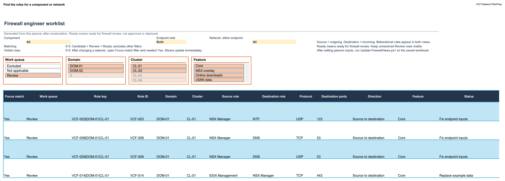
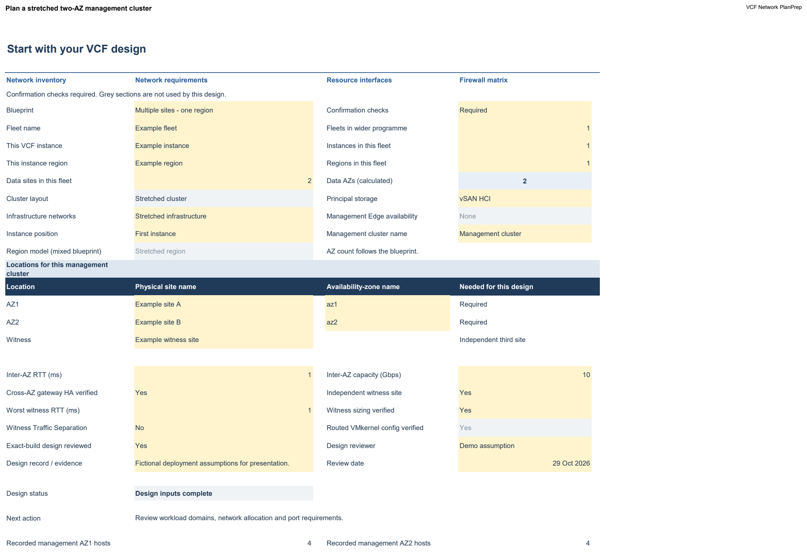
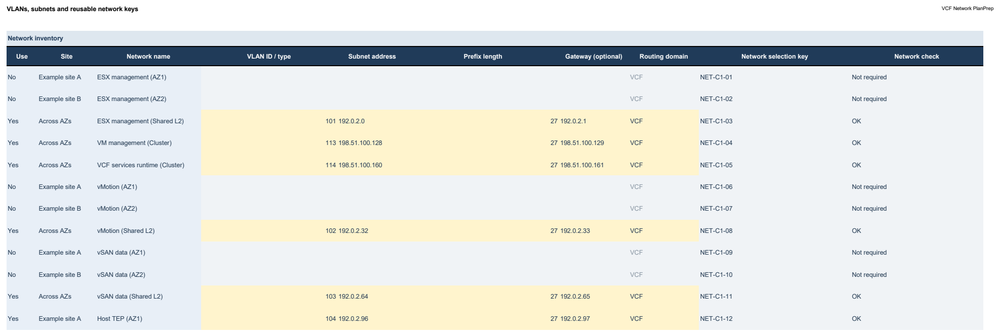
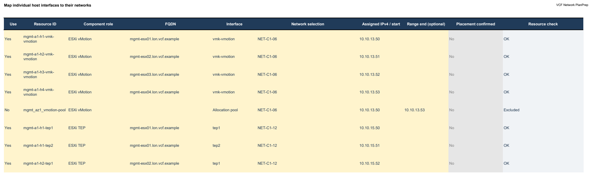
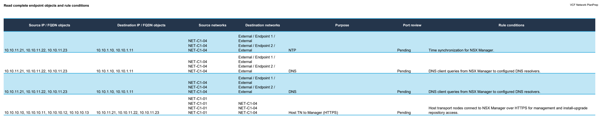
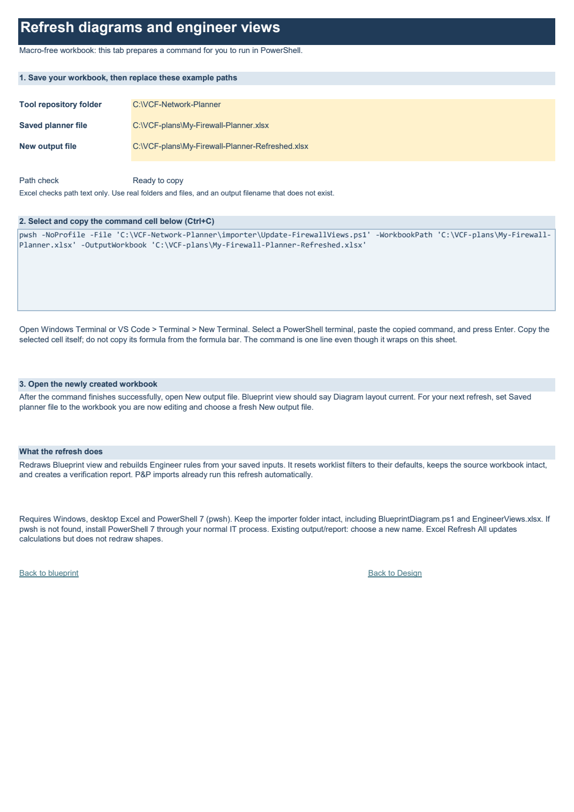
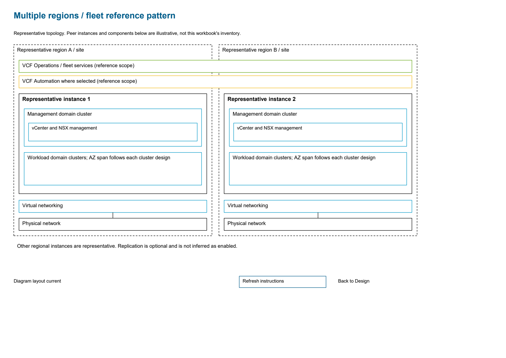
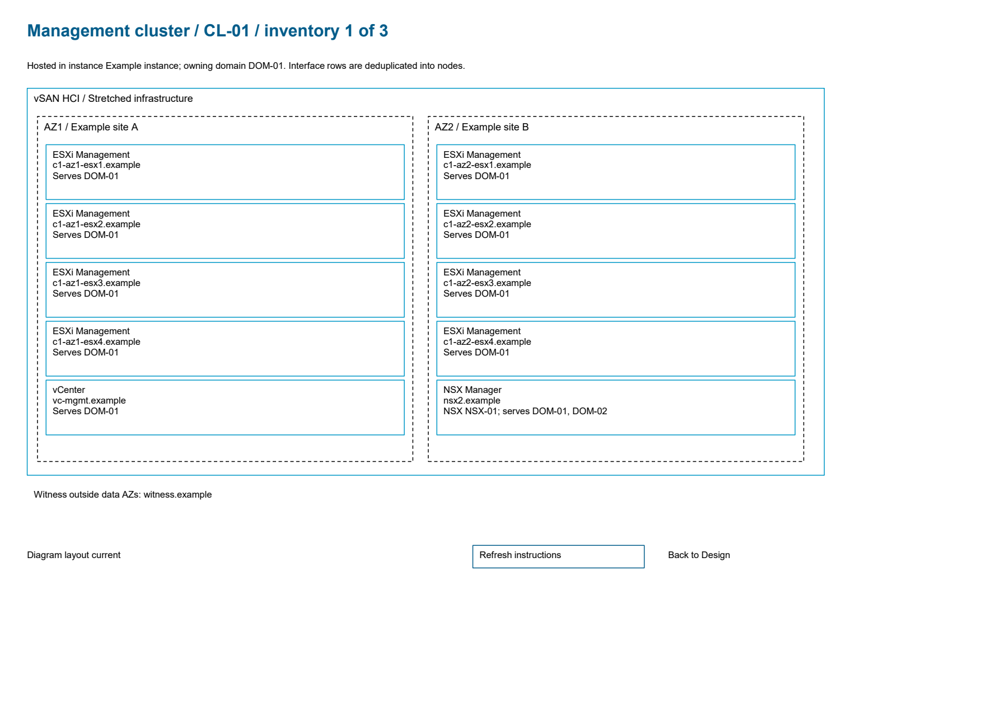

# VCF Network PlanPrep

An Excel network and firewall planner for VMware Cloud Foundation 9.1.1, with a tool that imports entered values from a Broadcom Planning and Preparation workbook.

Choose a deployment blueprint, record management and workload domain networks, bind resource interfaces to VLANs, and review the resulting firewall rule contexts. The planner checks addresses against the selected subnet and keeps formulas protected. The **Engineer rules** tab provides component, network, domain, cluster and feature filters over the calculated firewall matrix.

This is a community planning aid. Port records retain their source releases and qualifications in **Port library** and **Catalogue**; some baseline records are from VCF 9.1.0. Review applicability to your exact component builds before implementing rules. The tool does not configure firewalls or connect to VMware infrastructure.

## Start here

- [Download the reusable template](Firewall-Planner-Template.xlsx). It includes fictional starter data and cell tooltips.
- [Explore the stretched two-AZ example](examples/Stretched-Two-AZ.xlsx). Its network and resource checks are complete for the fictional scenario.
- [Import an existing P&P workbook](#import-a-planning-and-preparation-workbook) to avoid retyping its supported fields.



## Repository layout

```text
Firewall-Planner-Template.xlsx
README.md
importer/
  Import-VCFPlanningWorkbook.ps1
  vcf_import.py
  Apply-FirewallImport.ps1
  Update-FirewallViews.ps1
  BlueprintDiagram.ps1
  EngineerViews.xlsx
  example-config.json
examples/
  Single-Site.xlsx
  Stretched-Two-AZ.xlsx
  Multi-Region-London.xlsx
  Multi-Region-Frankfurt.xlsx
docs/images/
```

Keep the files in `importer/` together. `EngineerViews.xlsx` is an internal layout scaffold consumed by the refresh tool; start deployments with the root template.

## Requirements

| Task | Requirements |
| --- | --- |
| Fill in and review a workbook | Microsoft Excel desktop on Windows |
| Import a P&P workbook | Windows, desktop Excel, PowerShell 7 (`pwsh`) and Python 3.10 or later |
| Rebuild Engineer rules and Blueprint view after manual edits | Windows, desktop Excel and PowerShell 7 |
| Inspect an import without creating Excel output | Python 3.10 or later with `--dry-run` |

The importer uses the Python standard library: no `pip install`, VMware credentials, macros or cloud service are needed. The supported native workflow was checked with Excel 16.0 and PowerShell 7. Excel Online, LibreOffice and macOS are not validated substitutes for the protected slicers and native refresh workflow.

## Fill in the planner manually

Save a copy of the template outside this repository, then work through these tabs:

| Tab | What to enter or review |
| --- | --- |
| **Design** | Blueprint, fleet and instance, region, sites, AZs, storage and confirmation mode. AZ count follows the chosen blueprint and region model. |
| **Domains & clusters** | Management/workload domain ownership, clusters, planned host counts, NSX relationships and shared services. |
| **Blueprint view** | Native Excel diagrams: the representative fleet blueprint, followed by the selected instance's actual domain, cluster and resource inventory. |
| **Deployment** | Feature choices and the VLAN/network inventory: subnet, prefix, gateway, routing domain and optional local network name. |
| **Network plan** | Bind the required network purposes to inventory keys and record MTU/connectivity information. |
| **Resources** | FQDNs, individual interfaces, assigned IPs or explicit pools, location and domain/cluster ownership. |
| **Firewall matrix** | The authoritative calculated rule contexts, endpoint objects, status and conditions. |
| **Engineer rules** | A readable, filterable snapshot of that matrix. |
| **Engineer guide** | Filter instructions, queue totals and refresh details. |
| **Commands** (last tab) | Editable path fields, a copyable refresh command and step-by-step instructions. |
| **Port library / Catalogue / Guide** | Port definitions, evidence, release qualifications and further guidance. |

Yellow cells are inputs. Selecting an input displays its tooltip where one is provided. Grey sections may be inactive for the selected design or calculated. Formulas and workbook structure are protected; protection prevents accidental editing and is not access control or encryption.



Network starter rows respond to the design. Supply your actual VLAN IDs, subnet addresses, prefixes and gateways. A shared Layer 2 network uses one inventory key across AZs; separate site subnets use separate keys. These choices describe your design and do not establish connectivity by themselves.



Use a separate resource row for each host interface. Choose its network from the dropdown before entering the address. The planner checks subnet membership, unusable addresses, overlap, ownership and required host interfaces. **Recorded AZ hosts** counts populated management interfaces; selecting a two-AZ design does not invent hosts.



Replace fictional starter values before selecting **Live deployment** on Deployment. Do not rename the original sheets, move input cells or change fixed resource/network IDs to customise the layout: the importer and formulas use that schema.

## Import a Planning and Preparation workbook

Save the engineer's latest P&P changes first. Use the clean root template and a new output filename. From PowerShell 7 in the repository root:

```powershell
New-Item -ItemType Directory -Path "$HOME/VCF-plans" -Force

./importer/Import-VCFPlanningWorkbook.ps1 `
  -PlanningWorkbook "C:/path/vcf-9.1.1-planning-and-preparation-workbook.xlsx" `
  -FirewallTemplate "./Firewall-Planner-Template.xlsx" `
  -OutputWorkbook "$HOME/VCF-plans/My-Firewall-Planner.xlsx"
```

Use `-PythonPath "C:/path/python.exe"` if automatic Python discovery selects the wrong installation. Follow your organisation's normal process for running PowerShell scripts if execution is restricted.

For a preview, add `-DryRun`. It creates import reports without starting Excel or creating a planner. Use a different output name for the later real import, because existing workbooks and reports are never overwritten.

The equivalent Python entry point is:

```powershell
python ./importer/vcf_import.py `
  --source "C:/path/vcf-9.1.1-planning-and-preparation-workbook.xlsx" `
  --template "./Firewall-Planner-Template.xlsx" `
  --output "$HOME/VCF-plans/My-Firewall-Planner.xlsx"
```

Each successful import produces:

- `My-Firewall-Planner.xlsx`, including the refreshed engineer worklist and blueprint diagrams.
- `My-Firewall-Planner.import-report.txt`, the readable mapping/review report.
- `My-Firewall-Planner.import-report.json`, detailed mapping and verification information.
- `My-Firewall-Planner.views-report.json`, verification of the engineer view, source-field preservation, diagram inventory and save/reopen checks.

The source P&P and template are never saved. The tool stages a new planner, recalculates it in a separate Excel process, verifies it after reopening, and rebuilds the engineer view and blueprint diagrams. It publishes the workbook only after both stages succeed. Existing user Excel sessions are left alone.

Review the report and the five input tabs before using the rules. Imported workbooks enter **Live deployment** mode with generic examples cleared. An import is not an approval: missing values and unresolved mappings remain visible. Reimport into a new file from the clean template when the source changes; reimporting does not merge manual planner edits.

### Optional site and design configuration

Copy [example-config.json](importer/example-config.json) outside the repository and edit its fictional names. Pass it using `-Config "C:/path/my-config.json"` or Python `--config`. It provides fleet/region choices and physical site names that cannot reliably be inferred from the source. Supported sections are `design`, `mgmt`, `wld` and `cluster`; optional site keys include `az2_site` and `witness_site`.

An explicit `source_overrides` object can replace a supported, non-sensitive `input_*` field for one run. The report records overridden field names; the source workbook is unchanged.

### Individual host interfaces

Allocation pools do not say which address belongs to which host. The importer accepts explicit per-host named fields where present, a literal **Host allocation schedule** on the supplied example's **Example design** tab, or a `host_interfaces` array in your configuration:

```json
{
  "host_interfaces": [
    {
      "fqdn": "esx01.example",
      "purpose": "vmotion",
      "ip": "192.0.2.50",
      "interface": "vmk-vmotion"
    }
  ]
}
```

Supported purposes are `vmotion`, `vsan`, `host_overlay` and `nfs`. Provide the actual host FQDN and address from your design. Addresses must fit the corresponding subnet and any supplied pool. Unknown hosts, duplicate assignments and invalid addresses are rejected. No host addresses are allocated automatically. Where explicit assignments are supplied, corresponding pool rows remain present but inactive as reference data; the runtime pool remains a pool.

### Import coverage

| Source content | Behaviour |
| --- | --- |
| Management domain only | Imports it and emits `MANAGEMENT_ONLY`; workload data is not required. |
| Populated workload domain | Imports its supported identity, base-rack AZ1/AZ2 networks, hosts, vCenter and NSX nodes. |
| Workload section set to Exclude | Collects its entered values into inactive rows for review. |
| One additional cluster | Matches the explicitly named owning domain. An unresolved owner stays inactive and unbound. |
| Additional-instance licence server | Preserves its shared-service address as a `/32` endpoint, with PLAT-01 membership and no invented local hosted cluster. |
| Gateway/CIDR summary missing the prefix | Reads the original named input and reports the summary issue. |
| Missing or unsupported source fields | Reports the gap instead of inventing a mapping. |

One import handles one VCF instance: one management domain, one workload domain and one additional cluster from the supported P&P schema. The planner has capacity for four domains, four clusters, 144 inventory rows and 160 resource rows, but the importer does not automatically fill every available slot.

Additional racks, brownfield conversion, Edge/BGP, Supervisor, recovery and specialised storage workflows require manual mapping. Runtime component names do not reliably map to individual Fleet/Salt roles. Operations VIP binding and existing Operations hosting also require review. Missing DNS/NTP FQDNs are not inferred from IPs. No DNS queries are made.

The source is read as ZIP/XML. Only supported visible named input fields and workflow selectors are used; source formulas, sample columns, hidden defaults and authentication fields are not imported or executed.

## Confirmation checks

**Design!G6** offers two modes:

| Mode | Effect |
| --- | --- |
| **Required** | Default for the reusable template and importer. Placement, connectivity, design and port-review gates apply. |
| **Skip confirmations** | Greys the confirmation fields and bypasses their manual gates. Recorded answers remain unchanged. |

Skipping confirmations does not disable IP/subnet, overlap, topology, MTU, host-count, scope or missing-interface checks. Switching back to Required restores the manual gates. Qualified rows use **Mapped - confirmations skipped**, which remains in the engineer **Review** queue.

For an import demonstration, set `"confirmation_mode": "Skip confirmations"` in the configuration. Review fields are still visible; this option does not remove columns or record a Yes answer.

## Use and refresh the engineer worklist

The **Firewall matrix** recalculates with the model. Its existing filter hides rows with Status **Excluded** while retaining them underneath. Reapply that status filter after manual changes if visibility has not updated.

**Engineer rules** is a saved snapshot. It keeps the original direction, endpoint groups, ports and complete conditions, with a stable key for each rule/domain/cluster context. Counts represent contexts, not unique firewall commands or every individual endpoint pair.

1. Choose a component in **B6**, an endpoint side in **E6**, and optionally a network in **H6**.
2. After changing these yellow selectors, open the **Focus match** column filter and reselect **Yes**. The protected sheet may not enable Excel's ribbon Reapply command.
3. Use the Work queue, Domain, Cluster and Feature slicers; slicer selections apply immediately.
4. Scroll right for address objects, network keys, purpose, port review and full conditions.

**Source** means outgoing initiation from the component; **Destination** means incoming initiation. Bidirectional rules qualify on either side without swapping their saved endpoints. Network focus matches a complete network key at either endpoint. Domain/Cluster describes evaluation context, not necessarily the owner of every endpoint or the enforcing firewall.



| Work queue | Meaning |
| --- | --- |
| Candidate | Example-only candidate rows requiring port review. |
| Review | Unresolved, unfamiliar or confirmation-skipped statuses. Kept visible by default. |
| Ready | Ready for firewall review; not approved or deployed. |
| Not applicable | Unused contexts, disabled features, management-only exclusions or missing peer pairs. |
| Excluded | Rows explicitly excluded by the source matrix. |

The default worklist shows Candidate, Review and Ready. All source rows remain available through filters.

After changing planner inputs, save the workbook. Click **Refresh instructions** at the foot of any diagram page, or open **Commands**, the last tab.

1. Enter the folder containing this repo's `importer` subfolder, the saved planner's full path, and a new output filename in the three yellow fields.
2. Select the generated command cell and press **Ctrl+C**. Paste into a PowerShell terminal in Windows Terminal or VS Code, then press Enter. The command is one line even though Excel wraps it for display; copy the cell, not the formula bar.
3. Open the newly generated workbook. For the next refresh, update **Saved planner file** to the file you are now editing and choose another **New output file**.



The tab checks path text and quotes paths containing spaces or apostrophes. It cannot check whether folders/files exist or whether an output name is already used; the refresh script validates those when it runs. Example paths must be replaced. The tab prepares text and does not execute code inside Excel. The workbooks remain macro-free `.xlsx` files.

You can also run the refresh command directly:

```powershell
./importer/Update-FirewallViews.ps1 `
  -WorkbookPath "$HOME/VCF-plans/My-Firewall-Planner.xlsx" `
  -OutputWorkbook "$HOME/VCF-plans/My-Firewall-Planner-Refreshed.xlsx"
```

Refresh resets the selectors to All / Both / All and restores the default queues. It preserves the original input and calculation sheets, rebuilds **Blueprint view**, and creates a verification report. User-added diagram shapes are retained; shapes beginning `bp_` belong to the renderer. Excel **Refresh All** does not rebuild these generated views. Imports run the rebuild automatically.

## Read and refresh the blueprint diagrams

**Blueprint view** uses native Excel rectangles, connectors and formula-linked labels. The five fleet patterns use white backgrounds, square corners, dashed geographic boundaries, and coloured outlines for virtual infrastructure and fleet services.



The first page is a **reference pattern**, selected by **Design → Blueprint**. Its peer instances and optional components are illustrative. Fleet and region counts do not create inventory for other instances. The mixed blueprint also uses **Region model** to identify whether this workbook describes the stretched region or an additional single-AZ region.

The following pages show **this instance's recorded inventory**:

- Domains own clusters; each cluster's own AZ count controls its boundary.
- Appliances appear in their **hosted cluster**, with labels showing the domains they serve. Workload vCenters and NSX managers may therefore appear in the management cluster.
- Repeated interface rows are deduplicated into nodes. Shared NSX managers appear once, with their served domains listed.
- Witnesses, shared services and unresolved placements appear outside the data-AZ containers. A witness is not a third data AZ.
- Disabled features are not presented as deployed components. Contradictory or incomplete resource records appear in the unresolved inventory and review notes.



The diagram is a planning view, not discovered infrastructure. It does not establish connectivity or validate the deployment on its own. Use **Network plan**, **Resources** and the firewall views for interface addresses and rule details. Dense inventories continue onto additional pages at readable text sizes.

Names linked to cells can update when Excel recalculates. **Adding, removing or moving objects requires a redraw**: a plain `.xlsx` cannot change shape geometry through formulas alone. The footer displays **Diagram layout needs refresh** when the recorded inputs differ from the last redraw. Save your edits, then follow **Refresh instructions → Commands**, or run the `Update-FirewallViews.ps1` command shown above to produce a new workbook. The refresh updates both diagrams and Engineer rules and resets the worklist filters.

The refresh runs in its own Excel process and publishes only a verified output. If it fails, the previous workbook remains intact. Review changes in the newly generated file before using it. Diagram formulas and shapes are protected against accidental editing; this is still a macro-free `.xlsx`.

## Example workbooks

All names and addresses in these files are fictional. They are useful for exploring the workflow, not for deploying their address plans.

| Workbook | Demonstrates |
| --- | --- |
| [Single-Site.xlsx](examples/Single-Site.xlsx) | One site/region, management and workload domains, eight host management records and 32 explicit host interfaces. Shows the review gaps from a P&P import. |
| [Stretched-Two-AZ.xlsx](examples/Stretched-Two-AZ.xlsx) | Four management hosts in each AZ, stretched infrastructure networks, a separate witness site and two workload clusters. Confirmation answers describe fictional demo assumptions; ports remain pending review. |
| [Multi-Region-London.xlsx](examples/Multi-Region-London.xlsx) | First instance in a two-region fleet, local management/workload networking and fleet services. |
| [Multi-Region-Frankfurt.xlsx](examples/Multi-Region-Frankfurt.xlsx) | Second instance referencing London's shared licence service at fictional address 10.10.11.62. |

The regional example uses one data AZ per region. A region is not automatically a stretched AZ. Use one planner per VCF instance: these two regions have one instance each, so there are two planner files. Their rule contexts may include shared services; they are not a merged fleet-wide firewall command list.

The imported examples retain truthful review messages for missing FQDNs, runtime-role mapping and Operations placement. Their `.example` names may trigger **Replace example data** in Live deployment mode. The stretched example uses Examples mode and has no active network or endpoint input errors.

## Troubleshooting

| Message or symptom | Action |
| --- | --- |
| Existing output/report | Choose a new output basename, including after a dry run. |
| Unsupported source release/schema | Use the supported VCF 9.1.1 P&P layout; renamed/moved source fields need mapping review. |
| IP outside selected VLAN subnet | Check the network dropdown, subnet/prefix and assigned interface address. |
| Missing host interface | Enter an explicit address for that host/purpose; an allocation pool alone is insufficient. |
| Diagram layout needs refresh | Save edits, click **Refresh instructions**, and follow the **Commands** tab. Recalculation updates linked text but does not redraw topology. |
| Engineer rules looks unchanged | Save the planner and run the view refresh script. For selector changes alone, reselect Yes in Focus match. |
| Unresolved endpoint or design status | Review the import report and owning input tab; skipping confirmations will not fix technical input errors. |
| Excel automation fails | Read the error, save any intended source edits and retry to a new output name. The tool does not close your Excel session. |

## Reference material

The workbook retains links and qualifications for its port and blueprint sources. Useful starting points include the [Broadcom ports catalogue](https://ports.broadcom.com/) and the VCF blueprint pages for [a minimal single site](https://techdocs.broadcom.com/us/en/vmware-cis/vcf/vcf-9-0-and-later/9-1/design/design-blueprints-for/infrastructure-modernization/vcf-fleet-in-a-single-site-with-minimal-footprint-blueprint.html), [multiple sites in one region](https://techdocs.broadcom.com/us/en/vmware-cis/vcf/vcf-9-0-and-later/9-1/design/design-blueprints-for/infrastructure-modernization/vcf-fleet-with-multiple-sites-in-a-single-region-blueprint.html), and [multiple regions](https://techdocs.broadcom.com/us/en/vmware-cis/vcf/vcf-9-0-and-later/9-1/design/design-blueprints-for/infrastructure-modernization/vcf-fleet-with-multiple-sites-across-multiple-regions-blueprint.html).

